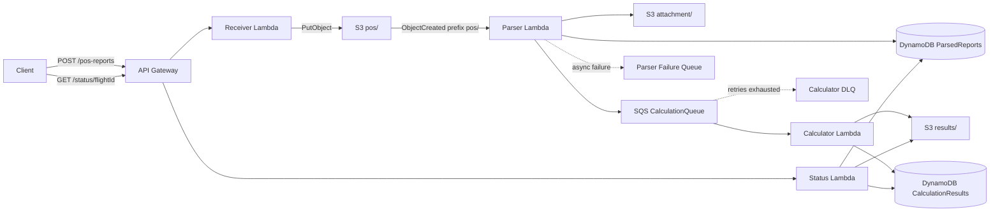

# POS Report Processing Pipeline — Senior Software Engineer Assessment

This is a C#/.NET 8 AWS serverless POS-report pipeline provisioned by AWS CDK TypeScript. This repository is **confidential**; do not publish it publicly.

## Architecture



## Requirements

- .NET 8 SDK, Node.js 20+, npm, AWS CLI configured with an account/region, CDK bootstrap permissions.
- No AWS credentials are stored in this repository.

## Local tests

```bash
dotnet restore PosReports.sln
dotnet build PosReports.sln
dotnet test PosReports.sln
cd infra
npm install
npm run build
npm test
```

## Deployment

From the repository root, publish C# first (CDK consumes `artifacts/lambda`):

```bash
./scripts/build-lambda.sh
cd infra
npm install
npm run build
npx cdk bootstrap  # once per account/region
npx cdk synth
npx cdk deploy
```

Windows PowerShell: `./scripts/build-lambda.ps1` then run the same `infra` commands.

All application resources are created by CDK. CDK bootstrapping is an AWS CDK prerequisite. This stack is configured for disposable assessment environments: S3/DynamoDB data are destroyed on `cdk destroy`.

## End-to-end verification

Use `ApiBaseUrl` from CDK outputs:

```bash
API='https://YOUR_API_ID.execute-api.YOUR_REGION.amazonaws.com/prod/'
curl -i -X POST "${API}pos-reports" -H 'Content-Type: text/plain' --data-binary 'POS/UL204.FR RGN/TO BKK/041205/N1642.3E09612.5/450/12500/2800'
# Use the returned flightId. Retry GET after asynchronous processing.
curl -i "${API}status/UL20420261004RGNBKK"
```

**Date caveat:** the `flightId` includes the **current UTC year and month at POST time** plus the message's day. Replace the example flight ID with the one actually returned by POST. A `PROCESSING` response or initial 404 is possible before processing completes.

To inspect the pipeline, check CloudWatch logs for the four Lambdas, the S3 prefixes, both DynamoDB tables, and SQS DLQs. After tests, `cd infra && npx cdk destroy`.

## Contracts

- `POST /pos-reports` text/plain: returns HTTP 202 `{ "flightId": "...", "status": "RECEIVED" }`; malformed input HTTP 400.
- `GET /status/{flightId}`: completed calculation `{ flightId, timestamp, remainingFlightTimeMinutes, estimatedFuelAtArrivalKg, lowFuelWarning }`; parsed but unfinished `{ flightId, status: "PROCESSING" }`; unknown flight HTTP 404.
- Parsed table: PK `flightId`, SK `timestamp` (report UTC minute), `attachment`, optional `fingerprint`.
- Results table: PK `flightId`, SK `timestamp` (calculation UTC time), `attachment`, optional `sourceReportTimestamp`.
- SQS body: `{ "flightId": "...", "timestamp": "..." }`.

## Decisions and limitations

1. **Date inference**: parser derives reception UTC year/month from raw S3 key, preventing month-boundary drift.
2. **Immutable attachment**: S3 conditional write + SHA-256 detects conflicting reports with the same flight and report minute. Conditional DynamoDB insert prevents overwrite.
3. **At-least-once delivery**: Parser can republish duplicate messages if it retries after saving metadata. Calculator checks previous result source timestamps (a strongly consistent paginated query) before calculating.
4. **Not exactly once**: simultaneous Calculator deliveries can race and create multiple results; the assessment schema does not provide an atomic source-report idempotency lock. S3 and DynamoDB are not one transaction.
5. **Partial failure**: result S3 write may succeed while DynamoDB write fails, leaving an orphan object. Retry can produce another result; orphan cleanup is out of scope.
6. **Status**: results are eventually available. `PROCESSING` is a documented extension to the minimal example response. The latest result is selected by calculation time, not by report time.
7. **Failure handling**: Calculator messages retry through SQS and then DLQ; parser asynchronous failures have a separate destination queue. Permanent malformed events require investigation/replay.
8. **Security**: IAM grants are resource-scoped, S3 is private, HTTPS enforced. API is unauthenticated because the assessment does not specify authentication; secure it before production use.
9. **Cost and lifecycle**: On-demand DynamoDB and small Lambda settings; AWS usage may still incur charges. Removal policies are destructive for this disposable assessment stack.
10. **Airport catalog**: static coordinates for RGN, BKK, SIN; unknown airports fail rather than silently substituting coordinates.

## Known validation limitations

- Receiver uses a roughly well-formed check and date validation; Parser validates coordinates and numeric values.
- Same flight/report-minute with differing contents is rejected rather than overwriting a prior report.
- Local .NET build and real AWS deployment must be verified in an environment with the required SDKs, dependencies, and credentials.

## Final verification (required before submission)

Run structural preflight first (no external dependencies):

```bash
python scripts/preflight.py
```

Then **on a machine with .NET 8 SDK, Node/npm, and AWS CLI**:

```bash
dotnet restore PosReports.sln
dotnet build PosReports.sln --no-restore
dotnet test PosReports.sln --no-build
./scripts/build-lambda.sh
cd infra
npm install
npm run build
npm test
npx cdk synth
npx cdk bootstrap
npx cdk deploy
```

Copy `ApiBaseUrl` from the deployment outputs and verify the live pipeline:

```bash
cd ..
python scripts/e2e_smoke.py 'https://YOUR_API.execute-api.REGION.amazonaws.com/prod/' 120
```

This checks successful POST, polls GET until a calculation is available, and checks invalid POST returns HTTP 400. It does **not** prove all failure/retry scenarios; inspect S3, DynamoDB, CloudWatch and both failure queues as well. Use `cd infra && npx cdk destroy` after testing to avoid leaving chargeable resources.

### Verification status when this source archive was prepared

- Source-level structural preflight: executed.
- .NET build and unit tests: **not executed** (dotnet SDK unavailable in preparation environment).
- CDK install/synth/tests: **not executed** (npm package cache missing; registry unavailable in preparation environment).
- AWS deployment and live E2E: **not executed** (no AWS CLI/account credentials in preparation environment).

**Do not claim the take-home is deployment-verified until these commands succeed.**

## Synthetic-only E2E validation and privacy

Run against **only an authorized assessment/dev AWS environment**, never production:

```powershell
python scripts/e2e_smoke.py "https://YOUR-API.execute-api.YOUR-REGION.amazonaws.com/prod" 120
```

The smoke test generates a fictitious `ZZ999` flight identifier and invented location/fuel values. It uses public airport codes for the calculator and never needs passenger, employee, customer or real operational flight data. Do not place personal data, credentials, production exports or real flight reports in tests, logs, commits or submissions. The endpoint must be HTTPS. A live AWS end-to-end test has not been run by the author of this patch.

## Assessment hardening (synthetic data only)

- **Duplicate delivery:** parsed metadata and attachment writes use conditional create and collision checks; the parser intentionally republishes after a duplicate S3 delivery so a failed previous SQS publish can recover. The calculator checks existing results for the same source report. **Limit:** this is best-effort deduplication, not a transactional exactly-once guarantee under concurrent consumers.
- **PII-safe application logs:** Lambda handlers log fixed event labels and exception **type names only**, never the raw POS request, S3 key, SQS message body, flight identifier, or exception message/stack. AWS service-generated access logs and payloads must be governed separately. Avoid enabling full request/response tracing in shared environments.
- **Failure handling:** calculator queue has a DLQ after five receives; S3-invoked parser has an asynchronous failure destination. Two CloudWatch alarms detect visible messages in the failure queues. These alarms have **no notification action**; configure a reviewed SNS destination for a production environment.
- **Retention:** application Lambda log groups use a seven-day retention setting. S3 and DynamoDB use assessment-only `DESTROY` policies and must not be deployed to production unchanged.
- **Tests:** in-memory tests cover duplicate deliveries, conflict detection, pending and missing status, invariant Gregorian timestamps and calculation inputs. The deployed smoke test uses a synthetic `ZZ999` flight identifier and synthetic numerical values; it refuses non-HTTPS endpoints.
- **Privacy:** use an isolated authorized AWS account and synthetic fixtures only. Never commit AWS credentials, `.env` files, personal data, or production reports. For a real deployment, consider KMS, stricter access boundaries, encryption and data retention requirements.

### Validation before submission

From the project root, run `dotnet test PosReports.sln` and `powershell.exe -NoProfile -ExecutionPolicy Bypass -File .\scripts\build-lambda.ps1`; then `cd infra`, `npm install`, `npm run build`, `npm test`, and `npx cdk synth`. Deploy and execute `python scripts/e2e_smoke.py <HTTPS-API-BASE-URL> 120` **only** in an authorized isolated test account. This revision has not been verified by a live AWS deployment in this environment.

**Repository note:** `.gitignore` explicitly includes `infra/bin/app.ts`; ensure this CDK entry point is committed, since the general `.NET` `bin/` ignore pattern would otherwise exclude it.
